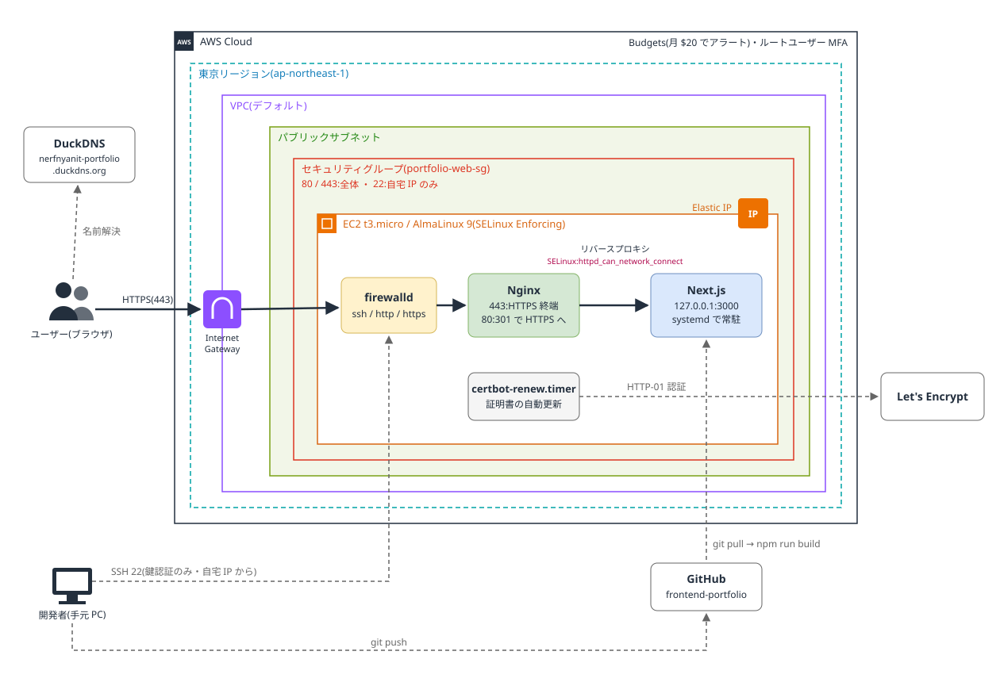
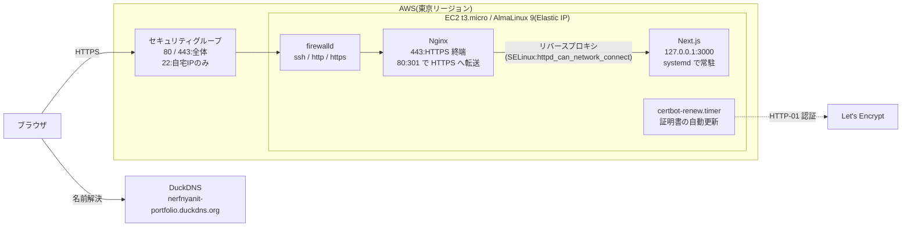

# Linux Server Lab

## ハイライト

- **多層防御**:SG・firewalld・SELinux に加えて、Next.js を `127.0.0.1` だけで待ち受けさせ、外の入口を Nginx だけにした(3000 番に外から届かないことを確認済み)
- **SELinux を切らずに解決**:リバースプロキシで出た 502 を、`error.log` と `ausearch` で SELinux の拒否と特定し、boolean で必要な接続だけを許可した
- **障害対応の訓練**:Nginx 停止・firewalld・設定ミス・アプリ停止・SELinux の 5 つの障害をわざと起こし、自力で切り分けて直し、すべて記録した([docs/troubleshooting.md](docs/troubleshooting.md))

## 概要

LinuC Level 1 と AWS CLF を取得したので、AWS を用いた Web サーバーのポートフォリオを作成しました。

- **目的**:一人で Linux サーバーを立て、Web サーバーとして公開できるようになるため
- **公開先**:https://nerfnyanit-portfolio.duckdns.org
- **期間**:10 日間(2026/10/22〜10/30)
- **費用**:0 円(AWS のクレジットの範囲内、ドメインは DuckDNS の無料サブドメイン)。最初にルートユーザーの MFA と予算アラート(AWS Budgets、月 $20)を設定してからリソースを作成
- **学んだこと**:AWS の使い方、最小権限の考え方、Nginx の導入、ポートの開放、障害時の切り分け方と考え方

## 構成図

通信の流れ(テキスト版)

## 使った技術

| 分類 | 使ったもの |
|---|---|
| OS | AlmaLinux 9(手元は VMware、本番は EC2)、SELinux(Enforcing のまま) |
| クラウド | AWS EC2(t3.micro)、EBS(gp3 20GiB)、Elastic IP、セキュリティグループ、Budgets |
| Web サーバー | Nginx(リバースプロキシ、HTTPS 終端) |
| アプリ | Next.js 16 / Node.js 24、systemd で常駐 |
| セキュリティ | SSH 鍵認証のみ・root ログイン禁止、firewalld、SELinux |
| ドメイン・証明書 | DuckDNS(無料)、Let's Encrypt + certbot(自動更新) |

## やったこと

- **Step 1:手元の VM(VMware + AlmaLinux 9)**
  - 本番(EC2)の前に、同じ手順を手元でリハーサルした
  - DHCP から手動設定(manual)に変えて、固定 IP にした
  - 一般ユーザーを作成し、sudo で実行させてログを残す(root で作業すると、複数人で運用しているときに誰が操作したかわからない)
  - SSH は鍵認証のみ + root ログイン禁止。root ログインができると、ユーザー名がわかっているのでパスワードさえ当てればよく、総当たり攻撃で突破されやすくなる。鍵認証にすると、秘密鍵を持っていなければそもそも攻撃できない
  - firewalld で、必要なサービス(ポート)だけを許可し、それ以外は止めた
  - Nginx で静的ページを公開した
  - systemd を用いてアプリを常駐させ、落ちても戻る・再起動しても戻る仕組みを導入した
- **Step 2:AWS EC2 で公開**
  - AWS EC2 を用いて Web サーバーを構築
  - Elastic IP で固定 IP にし、Step 1 の初期設定を適用
  - Next.js を systemd で常駐
  - SG(セキュリティグループ)で送信元 IP を絞り(SSH は自宅 IP のみ)、firewalld でサービス(ポート)単位の許可を設定して、多層防御にした
  - Nginx をリバースプロキシ(Next.js の中継役)にして、Next.js を外に直接さらさないようにした(Next.js は `127.0.0.1` だけで待ち受け)
  - SELinux は、プロセスがどのポートやファイルに触れてよいかを厳しく決めていて、許可されていない接続は止める
  - DuckDNS のサブドメインを使い、0 円で公開した
  - EPEL + certbot で通信を暗号化(HTTPS)し、証明書は自動更新
- **Step 3:壊して直す訓練・まとめ(手元の VM)**
  - 公開サーバーでは試さず、手元の VM でわざと障害を起こし、自力で切り分けて直した
    - a. Nginx の停止:`systemctl status` で `inactive (dead)` → `journalctl` で止まった時刻を確認して起動
    - b. firewalld で http が消えた:タイムアウト → `firewall-cmd --list-all` → `--permanent` で追加して `--reload`
    - c. 設定ファイルの書き間違い:`nginx -t` で行番号まで特定して修正し、起動
    - d. アプリのファイル権限:`journalctl -u` で `EACCES` → パーミッションを元に戻す
    - e. SELinux の拒否:502 の直後に `ausearch` → boolean で許可
  - 症状(タイムアウト / Connection refused / 502)で通信がどこまで届いているかを判断し、外側から順に切り分ける考え方を身につけた
  - ゼロから EC2 で公開するまでの手順書([docs/runbooks/deploy.md](docs/runbooks/deploy.md))を作った

## なぜそうしたか

- **固定IP**
  - DHCPのままだと、IPが自動で付与されていて変わることがあり、IPを前提にした設定(SSH の接続先など)が全部壊れるから
- **rootではなく一般ユーザー+sudo**
  - rootで直接作業すると、どのファイルでもpasswdでも変更できてしまうため、システムに直接影響する権限は普段使いしないようにする
  - うっかりミスの被害を減らす(間違ったコマンドを打っても、システム全体は壊れにくい)
  - sudoを使うとログ(`/var/log/secure`)が残る
- **鍵認証のみ**
  - パスワード認証のままだと、sshログインで総当たり攻撃ができるから
  - 総当たり攻撃が実質不可能
  - 秘密鍵がネットワークやサーバーに送られない
- **rootログイン禁止**
  - rootでログインされると、管理者が複数人いる場合に誰が操作したか分からなくなる
  - パスワードだけクラックすればよくなる
- **Nginx を前に置く(リバースプロキシ)**
  - 外の入口を Nginx だけにして、Next.js を外に直接さらさない
  - HTTPS の処理(証明書)や、HTTP から HTTPS への転送を Nginx にまとめられる
- **Next.js は `127.0.0.1` だけで待ち受け**
  - サーバーの中からしか届かないので、SG や firewalld の設定を間違えても、3000 番は外から届かない
- **アプリ専用のユーザー(ログイン不可)で動かす**
  - アプリが乗っ取られても、触れる範囲をそのユーザーの権限だけにする(最小権限)
- **SELinux を無効にしない**
  - 無効にするとアクセス制御そのものがなくなる。boolean で必要な接続だけを許可すれば、ほかの守りは残せる
- **Elastic IP**
  - EC2 を停止・起動するとパブリック IP が変わり、ドメインの向き先が壊れるため。使っていなくても課金されるので、片付けのときは必ず解放する
- **証明書の自動更新**
  - Let's Encrypt の証明書は 90 日で切れるため、`certbot-renew.timer` で自動更新し、`renew --dry-run` で更新できることを確認した

## 動作確認

公開後、次のことを確認した(2026/10/28)。

| 確認したこと | 方法 | 結果 |
|---|---|---|
| HTTPS で表示できる | `curl -I https://nerfnyanit-portfolio.duckdns.org` | `200` |
| HTTP は HTTPS に転送される | `curl -I http://nerfnyanit-portfolio.duckdns.org` | `301` → `https://` |
| 3000 番に外から届かない | 手元の PC から `Test-NetConnection <Elastic IP> -Port 3000` | 失敗(届かない) |
| Nginx のバージョンを出さない | レスポンスヘッダーの `Server:` | `nginx`(番号なし) |
| 証明書を自動更新できる | `sudo certbot renew --dry-run` | 成功 |
| 再起動しても元に戻る | `sudo reboot` のあと `systemctl is-active` など | nginx・portfolio・certbot-renew.timer が active、boolean が on、スワップ有効 |

## 障害対応の経験

- **Nginx のリバースプロキシを設定したら 502 Bad Gateway(EC2)**
  - `/var/log/nginx/error.log` に `connect() to 127.0.0.1:3000 failed (13: Permission denied)`
  - `ausearch -m avc` で、SELinux が Nginx(`httpd_t`)から 3000 番ポート(`ntop_port_t`)への TCP 接続(`name_connect`)を拒否していたと特定。Web サーバーが外へ接続することは、既定では許可されていない
  - SELinux は最小限のことだけを許可するので、boolean で `httpd_can_network_connect` を on にして、Web サーバーのネットワーク接続を許可した
- **sshd の設定を変えたのに、パスワードでログインできてしまう(VM)**
  - コマンドの打ち間違い(`reload` → `reroad`)で、設定が反映されていなかった
  - CLI では何が起きているかわかりにくいので、確認を習慣にする。`systemctl status` で Reloaded の記録を確認し、実際に接続して確かめる
- **書き込めなかったユニットファイルに `chmod a+rwx` してしまった(VM)**
  - 最小権限での構築を進めていて、書き込みができないと思って権限を付与してしまった
  - 一般ユーザーが root の権限を取れる状態は root と同じで、一般ユーザーを作った意味がない。sudo を使わせることに意味がある

詳しい切り分けの記録は [docs/troubleshooting.md](docs/troubleshooting.md) を参照。

## 再現手順

ゼロから EC2 で公開するまでの手順は [docs/runbooks/deploy.md](docs/runbooks/deploy.md) を参照。

## 今後やりたいこと

- EC2 の更新手順をシェルスクリプトにまとめて自動化する
- バックエンド(API)と DB を追加して、フルスタックの構成にする
- Terraform を用いて、AWS の構成(EC2・SG・Elastic IP など)をコードで管理する
