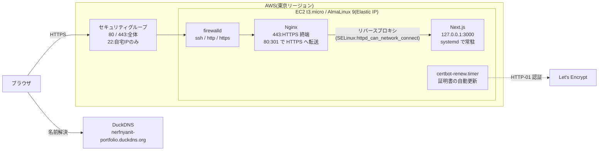

# Linux Server Lab

## 概要

LinuC Level 1 と AWS CLF を取得したので、AWS を用いた Web サーバーのポートフォリオを作成しました。

- **目的**:一人で Linux サーバーを立て、Web サーバーとして公開できるようになるため
- **公開先**:https://nerfnyanit-portfolio.duckdns.org
- **学んだこと**:AWS の使い方、最小権限の考え方、Nginx の導入、ポートの開放、障害時の切り分け方と考え方

## 構成図

## 使った技術

| 分類 | 使ったもの |
|---|---|
| OS | AlmaLinux 9(手元は VMware、本番は EC2)、SELinux(Enforcing のまま) |
| クラウド | AWS EC2(t3.micro)、EBS(gp3 20GiB)、Elastic IP、セキュリティグループ、Budgets |
| Web サーバー | Nginx(リバースプロキシ、HTTPS 終端) |
| アプリ | Next.js 16 / Node.js 24、systemd で常駐 |
| セキュリティ | SSH 鍵認証のみ・root ログイン禁止、firewalld、SELinux |
| ドメイン・証明書 | DuckDNS(無料)、Let's Encrypt + certbot(自動更新) |

## やったこと

- **Step 1:手元の VM(VMware + AlmaLinux 9)**
  - 本番(EC2)の前に、同じ手順を手元でリハーサルした
  - DHCP から手動設定(manual)に変えて、固定 IP にした
  - 一般ユーザーを作成し、sudo で実行させてログを残す(root で作業すると、複数人で運用しているときに誰が操作したかわからない)
  - SSH は鍵認証のみ + root ログイン禁止。root ログインができると、ユーザー名がわかっているのでパスワードさえ当てればよく、総当たり攻撃で突破されやすくなる。鍵認証にすると、秘密鍵を持っていなければそもそも攻撃できない
  - firewalld で、必要なサービス(ポート)だけを許可し、それ以外は止めた
  - Nginx で静的ページを公開した
  - systemd を用いてアプリを常駐させ、落ちても戻る・再起動しても戻る仕組みを導入した
- **Step 2:AWS EC2 で公開**
  - AWS EC2 を用いて Web サーバーを構築
  - Elastic IP で固定 IP にし、Step 1 の初期設定を適用
  - Next.js を systemd で常駐
  - SG(セキュリティグループ)で送信元 IP を絞り(SSH は自宅 IP のみ)、firewalld でサービス(ポート)単位の許可を設定して、多層防御にした
  - Nginx をリバースプロキシ(Next.js の中継役)にして、Next.js を外に直接さらさないようにした(Next.js は `127.0.0.1` だけで待ち受け)
  - SELinux は、プロセスがどのポートやファイルに触れてよいかを厳しく決めていて、許可されていない接続は止める
  - DuckDNS のサブドメインを使い、0 円で公開した
  - EPEL + certbot で通信を暗号化(HTTPS)し、証明書は自動更新

## なぜそうしたか

- **固定IP**
  - DHCPのままだと、IPが自動で付与されていて定期的にIPが自動で変更され、IPを前提にした設定が全部壊れるから
- **rootではなく一般ユーザー+sudo**
  - rootで直接作業すると、root権限でファイルの操作やpasswdなども変更できるため、動作環境に直接作用するものは普段使いできないようにする
  - うっかりミスの被害を減らす(間違ったコマンドを打っても、システム全体は壊れにくい)
  - sudoを使うとログ(`/var/log/secure`)が残る
- **鍵認証のみ**
  - パスワード認証のままだと、sshログインで総当たり攻撃ができるから
  - 総当たり攻撃が実質不可能
  - 秘密鍵がネットワークやサーバーに送られない
- **rootログイン禁止**
  - rootでログインされると、管理者が複数人いる場合に誰が操作したか分からなくなる
  - パスワードだけクラックすればよくなる

## 障害対応の経験

## 再現手順

## 今後やりたいこと

