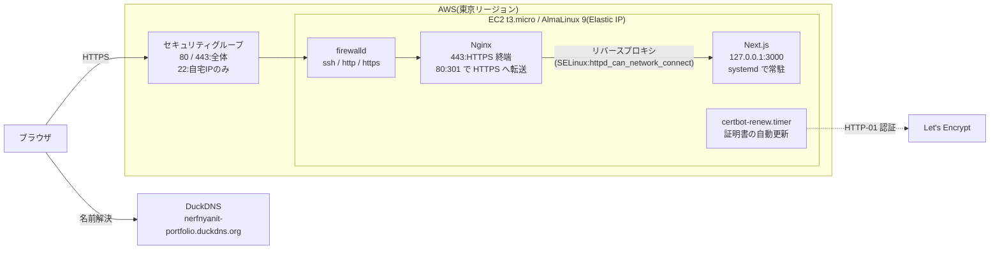

# Linux Server Lab

## ハイライト

- **多層防御**:SG・firewalld・SELinux に加えて、Next.js を `127.0.0.1` だけで待ち受けさせ、外の入口を Nginx だけにした(3000 番に外から届かないことを確認済み)
- **SELinux を切らずに解決**:リバースプロキシで出た 502 を、`error.log` と `ausearch` で SELinux の拒否と特定し、Enforcing のまま boolean(`httpd_can_network_connect`)で Web サーバーからのネットワーク接続を許可した
- **障害対応の訓練**:Nginx 停止・firewalld・設定ミス・アプリ停止・SELinux の 5 つの障害をわざと起こし、自力で切り分けて直し、すべて記録した([docs/troubleshooting.md](docs/troubleshooting.md))

## 概要

LinuC Level 1 と AWS CLF を取得したので、AWS を用いた Web サーバーのポートフォリオを作成しました。

- **目的**:一人で Linux サーバーを立て、Web サーバーとして公開できるようになるため
- **公開先**:<https://nerfnyanit-portfolio.duckdns.org>
- **公開しているアプリ本体**:[nerfnyanit/frontend-portfolio](https://github.com/nerfnyanit/frontend-portfolio)
- **期間**:9 日間(2026/10/22〜10/30)
- **費用**:自己負担 0 円。AWS の利用料(EC2・EBS・パブリック IPv4 で月 約 $15)は発生しているが、AWS のクレジットで充当している。ドメインは DuckDNS の無料サブドメイン。2026/12/22(クレジットの期限)までにリソースを削除する予定
- **費用管理**:最初にルートユーザーの MFA と予算アラート(AWS Budgets、月 $20)を設定してからリソースを作成。予算アラートはメールで通知するだけで、リソースを自動で止めるものではない
- **学んだこと**:AWS の使い方、最小権限の考え方、Nginx の導入、ポートの開放、障害時の切り分け方と考え方

## 構成図

通信の流れ(テキスト版)

## 使った技術

| 分類 | 使ったもの |
|---|---|
| OS | AlmaLinux 9(手元は VMware、本番は EC2)、SELinux(Enforcing のまま) |
| クラウド | AWS EC2(t3.micro)、EBS(gp3 20GiB)、Elastic IP、セキュリティグループ、Budgets |
| Web サーバー | Nginx(リバースプロキシ、HTTPS 終端) |
| アプリ | Next.js 16 / Node.js 24、systemd で常駐 |
| セキュリティ | SSH 鍵認証のみ・root ログイン禁止、firewalld、SELinux |
| ドメイン・証明書 | DuckDNS(無料)、Let's Encrypt + certbot(自動更新) |

## やったこと

- **Step 1:手元の VM(VMware + AlmaLinux 9)**
  - 本番(EC2)の前に、同じ手順を手元でリハーサルした
  - DHCP から手動設定(manual)に変えて、固定 IP にした
  - 一般ユーザーを作成し、sudo で実行させてログを残す(root で作業すると、複数人で運用しているときに誰が操作したかわからない)
  - SSH は鍵認証のみ + root ログイン禁止。root ログインができると、ユーザー名がわかっているのでパスワードさえ当てればよく、総当たり攻撃で突破されやすくなる。鍵認証にすると、秘密鍵を持っていなければそもそも攻撃できない
  - firewalld で、必要なサービス(ポート)だけを許可し、それ以外は止めた
  - Nginx で静的ページを公開した
  - systemd を用いてアプリを常駐させ、落ちても戻る・再起動しても戻る仕組みを導入した
- **Step 2:AWS EC2 で公開**
  - AWS EC2 を用いて Web サーバーを構築
  - Elastic IP で固定 IP にし、Step 1 の初期設定を適用
  - Next.js を systemd で常駐
  - SG(セキュリティグループ)で送信元 IP を絞り(SSH は自宅 IP のみ)、firewalld でサービス(ポート)単位の許可を設定して、多層防御にした
  - Nginx をリバースプロキシ(Next.js の中継役)にして、Next.js を外に直接さらさないようにした(Next.js は `127.0.0.1` だけで待ち受け)
  - SELinux は Enforcing のまま運用し、Nginx から Next.js への接続で出た拒否は boolean で許可した(無効化はしていない)
  - DuckDNS のサブドメインを使い、0 円で公開した
  - EPEL + certbot で通信を暗号化(HTTPS)し、証明書は自動更新
  - 証跡を取るために `ss -tlnp` を実行したところ、AMI に最初から入っていた rpcbind(111 番)が待ち受けていたことに気づいた。SG と firewalld で外からは届かなかったが、使わないサービスなので停止・無効化した([証跡](evidence/02-ec2-checks.txt))
- **Step 3:壊して直す訓練・まとめ(手元の VM)**
  - 公開サーバーでは試さず、手元の VM でわざと障害を起こし、自力で切り分けて直した。障害は Claude が作ったスクリプトでランダムに 1 つずつ仕込み、どれが仕込まれたかを知らない状態で切り分けた
    - a. Nginx の停止:`systemctl status` で `inactive (dead)` → `journalctl` で正常に停止された時刻を確認して起動
    - b. firewalld で http が消えた:タイムアウト → `firewall-cmd --list-all` → `--permanent` で追加して `--reload`
    - c. 設定ファイルの書き間違い:`nginx -t` で行番号まで特定して修正し、起動
    - d. アプリのファイル権限:`journalctl -u` で `EACCES` → パーミッションを元に戻す
    - e. SELinux の拒否:502 の直後に `ausearch` → boolean で許可
  - 症状(タイムアウト / Connection refused / 502)から通信がどこまで届いていそうかを推測し、外側から順に確かめる考え方を身につけた(例:タイムアウトなら firewalld・SG・経路・サーバーの停止を順に確認する)
  - うまくいかなかったこと:訓練 c は、仕込みのスクリプトの不具合で 1 回やり直した。e と同じ障害は前日の準備中にも起きており、そのときは再起動してから `ausearch` して記録が出なかったり、別の URL で直ったと判断したりした。本番の訓練では、その反省を活かして一度で特定した
  - ゼロから EC2 で公開するまでの手順書([docs/runbooks/deploy.md](docs/runbooks/deploy.md))を作った

## なぜそうしたか

- **固定IP**
  - DHCPのままだと、IPが自動で付与されていて変わることがあり、IPを前提にした設定(SSH の接続先など)が全部壊れるから
- **rootではなく一般ユーザー+sudo**
  - rootで直接作業すると、どのファイルでもpasswdでも変更できてしまうため、システムに直接影響する権限は普段使いしないようにする
  - うっかりミスの被害を減らす(間違ったコマンドを打っても、システム全体は壊れにくい)
  - sudoを使うとログ(`/var/log/secure`)が残る
- **鍵認証のみ**
  - パスワード認証のままだと、sshログインで総当たり攻撃ができるから
  - 総当たり攻撃が実質不可能
  - 秘密鍵がネットワークやサーバーに送られない
- **rootログイン禁止**
  - rootでログインされると、管理者が複数人いる場合に誰が操作したか分からなくなる
  - パスワードだけクラックすればよくなる
- **Nginx を前に置く(リバースプロキシ)**
  - 外の入口を Nginx だけにして、Next.js を外に直接さらさない
  - HTTPS の処理(証明書)や、HTTP から HTTPS への転送を Nginx にまとめられる
- **Next.js は `127.0.0.1` だけで待ち受け**
  - サーバーの中からしか届かないので、SG や firewalld の設定を間違えても、3000 番は外から届かない
- **アプリ専用のユーザー(ログイン不可)で動かす**
  - アプリが乗っ取られても、触れる範囲をそのユーザーの権限だけにする(最小権限)
- **SELinux を無効にしない**
  - 無効にすると SELinux によるアクセス制御がなくなる。boolean なら、必要になった種類の許可(Web サーバーからのネットワーク接続)だけを足して、ほかのポリシーは残せる
  - ただし `httpd_can_network_connect` は 3000 番だけでなく、Web サーバーから**どのポートへの接続も**許可する。さらに絞るなら、ポートのラベルを変える方法がある(今後の課題)
- **Elastic IP**
  - EC2 を停止・起動するとパブリック IP が変わり、ドメインの向き先が壊れるため。使っていなくても課金されるので、片付けのときは必ず解放する
- **証明書の自動更新**
  - Let's Encrypt の証明書は 90 日で切れるため、`certbot-renew.timer` で自動更新し、`renew --dry-run` で更新できることを確認した

## 動作確認

公開後(2026/10/28)に確認し、2026/10/30 にもう一度実行して、実際の出力を [evidence/](evidence/) に残した。

| 確認したこと | 方法 | 結果 | 証跡 |
|---|---|---|---|
| HTTPS で表示できる | 【手元】`curl -I https://nerfnyanit-portfolio.duckdns.org` | `200` | [01](evidence/01-external-checks.txt) |
| HTTP は HTTPS に転送される | 【手元】`curl -I http://nerfnyanit-portfolio.duckdns.org` | `301` → `https://` | [01](evidence/01-external-checks.txt) |
| Nginx のバージョンを出さない | 上のレスポンスヘッダーの `Server:` | `nginx`(番号なし) | [01](evidence/01-external-checks.txt) |
| 3000 番に外から届かない | 【手元】`Test-NetConnection <Elastic IP> -Port 3000` | `TcpTestSucceeded : False` | [01](evidence/01-external-checks.txt) |
| 3000 番は `127.0.0.1` だけで待ち受け | 【EC2】`sudo ss -tlnp` | `127.0.0.1:3000` | [02](evidence/02-ec2-checks.txt) |
| SSH は公開鍵以外・root を拒否 | 【EC2】`sudo sshd -T`、【手元】鍵なし・root での `ssh` | 実効値が no、`Permission denied` | [01](evidence/01-external-checks.txt)・[02](evidence/02-ec2-checks.txt) |
| 証明書を自動更新できる | 【EC2】`sudo certbot renew --dry-run` | `all simulated renewals succeeded` | [02](evidence/02-ec2-checks.txt) |
| 再起動しても元に戻る | 【EC2】10/28 に `sudo reboot` → `systemctl is-active` など | nginx・portfolio・certbot-renew.timer が active、boolean が on、スワップ有効 | [02](evidence/02-ec2-checks.txt) |

## 障害対応の経験

- **Nginx のリバースプロキシを設定したら 502 Bad Gateway(EC2)**
  - `/var/log/nginx/error.log` に `connect() to 127.0.0.1:3000 failed (13: Permission denied)`
  - `ausearch -m avc` で、SELinux が Nginx(`httpd_t`)から 3000 番ポート(`ntop_port_t`)への TCP 接続(`name_connect`)を拒否していたと特定。Web サーバーがネットワーク接続することは、既定では許可されていない
  - SELinux は Enforcing のまま、boolean で `httpd_can_network_connect` を on にして、Web サーバーからのネットワーク接続を許可した
- **sshd の設定を変えたのに、パスワードでログインできてしまう(VM)**
  - コマンドの打ち間違い(`reload` → `reroad`)で、設定が反映されていなかった
  - CLI では何が起きているかわかりにくいので、確認を習慣にする。`systemctl status` で Reloaded の記録を確認し、実際に接続して確かめる
- **書き込めなかったユニットファイルに `chmod a+rwx` してしまった(VM)**
  - 最小権限での構築を進めていて、書き込みができないと思って権限を付与してしまった
  - 一般ユーザーが root の権限を取れる状態は root と同じで、一般ユーザーを作った意味がない。sudo を使わせることに意味がある

詳しい切り分けの記録は [docs/troubleshooting.md](docs/troubleshooting.md) を参照。

## 再現手順

ゼロから EC2 で公開するまでの手順は [docs/runbooks/deploy.md](docs/runbooks/deploy.md) を参照。

## できなかったこと・未解決

- レスポンスヘッダーに `X-Powered-By: Next.js` が出ている(`next.config.ts` に `poweredByHeader: false` を入れて再デプロイする予定)
- HSTS などのセキュリティヘッダーは未設定
- fail2ban(SSH の総当たり対策)と dnf-automatic(セキュリティ更新の自動適用)は未導入(任意項目)
- SSH は password と keyboard-interactive を無効にしているが、AlmaLinux 既定の GSSAPI 認証は有効のまま(Kerberos は未設定のため使えないが、厳密には「公開鍵のみ」ではない。`GSSAPIAuthentication no` で無効にできる)
- `httpd_can_network_connect` は接続先のポートを絞れていない(上の「SELinux を無効にしない」を参照)
- 冗長化・バックアップ・監視は、今回の範囲外

## AI(Claude)の利用について

学習のコーチとして Claude Code を使った。運用ルールは [CLAUDE.md](CLAUDE.md) にある。

- **本人が行ったこと**:サーバー上のコマンドの実行(すべて)、設定ファイル(sshd・Nginx・systemd)の作成、障害の切り分けと復旧、障害記録と手順書の元になる内容
- **Claude が担当したこと**:方針とコマンドの意味の説明、設定ファイルのレビュー、詰まったときのヒント、訓練用に障害を仕込むスクリプトの作成
- **文章について**:README・手順書・障害記録の一部の文章と構成図は、本人の記録とメモをもとに Claude が下書き・整形し、本人が内容を確認した。コミットに Claude が共同作成者として表示されるのはこのため

## 今後やりたいこと

- EC2 の更新手順をシェルスクリプトにまとめて自動化する
- バックエンド(API)と DB を追加して、フルスタックの構成にする
- Terraform を用いて、AWS の構成(EC2・SG・Elastic IP など)をコードで管理する
